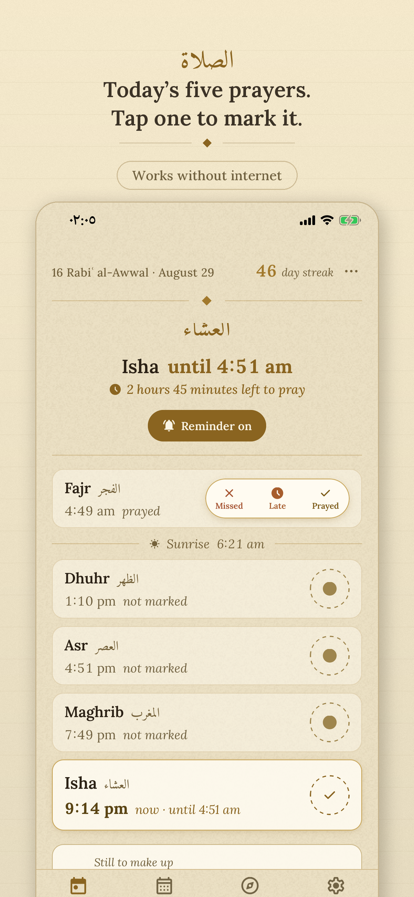
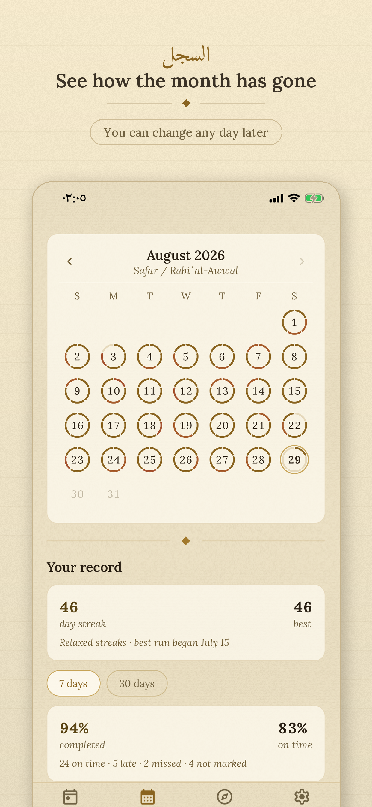
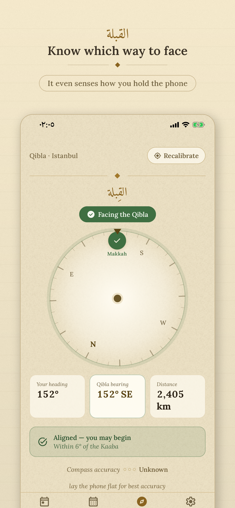

# Simple Prayer

Simple Prayer is an open-source Muslim prayer times, qibla and salah tracking app for iPhone,
Android, Apple Watch and Wear OS. It shows your five daily prayer times, points you to the qibla,
and lets you mark a prayer with one tap.

It is free, with no ads, no account and no paid features. The code is open source under the MIT
license, so anyone can read it, build it and learn from it. There is an optional tip jar, and a tip
unlocks nothing.

<p>
  
  
  
</p>

[App Store](https://apps.apple.com/us/app/simple-prayer-times-qibla/id6803004652) ·
[Google Play](https://play.google.com/store/apps/details?id=app.simpleprayer) ·
[simpleprayer.app](https://simpleprayer.app)

## What it does

- **Prayer times.** Worked out on your phone, so they work with no internet. The app picks the
  method used in your country (Diyanet, ISNA, Umm al-Qura, Egyptian, Karachi and others). You can
  change it, move any prayer by a few minutes, and choose Hanafi or Shafi Asr.
- **Reminders.** Up to three for each prayer: the adhan, an earlier one, and a last one before the
  time ends. Each can be silent, a tone, or the adhan.
- **The log.** Tap a prayer to mark it as prayed. You can also mark one as late or missed, and
  change any day later in History. Streaks, excused days, travel mode and a qada counter are all
  there if you want them. If you only want the times, nothing asks you to log anything.
- **Qibla.** A compass that shows the Kaaba and tells you which way to turn. You do not have to
  hold the phone flat.
- **Widgets.** Home screen widgets on both platforms, and Lock Screen widgets, StandBy and a Live
  Activity on iPhone. You can mark a prayer from a widget.
- **Watches.** An Apple Watch app with complications, a Wear OS app with a tile and complications,
  and a Wear OS watch face called Manuscript.
- **Prayer buddies.** If you and someone you choose both turn it on, each of you can see that the
  other prayed today. It is off until you turn it on.
- **Four languages.** English, Arabic, Turkish and Urdu. Each is written for its readers, not
  copied word for word from the English. The Urdu was written with AI help and has not yet been
  checked by a native speaker, so corrections are welcome. Arabic and Urdu are laid out right to
  left, and Urdu is set in Nastaliq.

## Privacy

There is no account and no analytics, and there are no ads. Your prayer log is kept on your phone.

Some things do go over the internet, and the [privacy policy](docs/PRIVACY_POLICY.md) explains
each one:

- the city lookup, which goes to your phone's own map service (Apple or Google);
- a check for app updates, run by Expo;
- crash reports, sent to Sentry. They are on by default, and you can switch them off in Settings;
- a tip, if you leave one, through the App Store or Google Play;
- buddy mode, if you turn it on. The prayers you mark pass through a small relay of ours to your
  buddy's phone.

## Open source: check it yourself

All of the app's code is in this repository, so you can check what it does instead of trusting
us. The two places to start:

- [docs/PRIVACY_POLICY.md](docs/PRIVACY_POLICY.md) lists everything that leaves your phone. A
  test, `src/__tests__/privacyClaims.test.ts`, fails the build if the app's own privacy text
  claims more than the code does.
- The buddy relay has its own repository:
  [majani-plus/simple-prayer-relay](https://github.com/majani-plus/simple-prayer-relay). Its
  README explains, step by step, what is sent, what is kept and for how long. The relay is not
  end-to-end encrypted, and the README and the policy both explain why.

You can also build the app yourself. [docs/BUILD_YOURSELF.md](docs/BUILD_YOURSELF.md) shows how.

## Built on

Simple Prayer is built on other people's careful work. Thank you to all of them.

- **[adhan-js](https://github.com/batoulapps/adhan-js) by Batoul Apps** works out every prayer
  time in the app. It is the reason the times work offline, and it is carefully made. While
  building Simple Prayer we found some problems and sent fixes back as pull requests #208 to
  #213. The maintainers took the fixes in as #232 to #236. #234, #235 and #236 keep our commits.
  #233 is the maintainer's version, rebased from our #209. #232 is the maintainer's own, broader
  rewrite, which replaced our #208. Our #212, which fixes the CommonJS build, was merged directly
  and shipped in adhan 4.4.6, the version this app uses. Thank you to the maintainers for reading
  our work so carefully.
- **[Amiri](https://github.com/aliftype/amiri) by Khaled Hosny** is the Arabic typeface for the
  prayer names and other large Arabic words.
- **[Noto Naskh Arabic](https://github.com/notofonts/arabic)** from the Noto project is the
  Arabic typeface for the rest of the Arabic text.
- **[Noto Nastaliq Urdu](https://github.com/notofonts/nastaliq)** from the Noto project is the
  Urdu typeface.
- **[Lora](https://github.com/cyrealtype/Lora-Cyrillic)** by Cyreal is the Latin typeface.
- **[ICU](https://icu.unicode.org/)** (International Components for Unicode) gave us the table of
  Umm al-Qura month lengths behind the Hijri date.
- **[GeoNames](https://www.geonames.org/)** gave us the city list on the website.
- **[Expo](https://expo.dev/)** and React Native are what the app is built with.

[THIRD_PARTY_NOTICES.md](THIRD_PARTY_NOTICES.md) has the full list, with every licence.

## Helping

- [CONTRIBUTING.md](CONTRIBUTING.md): how to set up, the checks to run, and the project's rules.
- [docs/TRANSLATING.md](docs/TRANSLATING.md): how to improve a language or add a new one.
- [docs/TONE.md](docs/TONE.md): how the app writes. Please read it before changing any text.
- [SECURITY.md](SECURITY.md): how to report a security problem.

## Development

The project uses [bun](https://bun.sh).

```sh
bun install
bunx expo start        # then i (iOS simulator) / a (Android emulator)
bun run typecheck && bun run lint && bun run test
```

The stack: Expo (React Native, TypeScript), Expo Router, Zustand with immer, expo-sqlite with
Drizzle, MMKV, Reanimated, i18next and adhan-js.

One codebase makes the iPhone app (with its widgets, Live Activity and Apple Watch app), the
Android app (with its widgets), the Wear OS app (`wear/`) and the Manuscript watch face
(`wear-face/`). The watches and widgets show a snapshot that the phone works out. There is no
prayer logic in Swift or Kotlin. See [docs/ARCHITECTURE.md](docs/ARCHITECTURE.md).

## Documentation

| Doc | What it is |
|---|---|
| [docs/PRODUCT_SPEC.md](docs/PRODUCT_SPEC.md) | What the app does, in full |
| [docs/DESIGN.md](docs/DESIGN.md) | The visual design: colours, type, components |
| [docs/ARCHITECTURE.md](docs/ARCHITECTURE.md) | Stack, folders, data model, conventions |
| [docs/DECISIONS.md](docs/DECISIONS.md) | Every product decision, and why |
| [docs/TONE.md](docs/TONE.md) | How the app writes |
| [docs/TRANSLATING.md](docs/TRANSLATING.md) | Languages and translation |
| [docs/PRIVACY_POLICY.md](docs/PRIVACY_POLICY.md) | The published privacy policy |
| [docs/TERMS_OF_USE.md](docs/TERMS_OF_USE.md) | The published terms of use |
| [docs/STORE_DESCRIPTIONS.md](docs/STORE_DESCRIPTIONS.md) | The store listing text |
| [docs/WEBSITE.md](docs/WEBSITE.md) | The website, simpleprayer.app |
| [CLAUDE.md](CLAUDE.md) | Working rules for AI coding agents |

## Licence

Simple Prayer is made by [Ronny Majani](https://ronnymajani.com) and owned by Majani Plus LLC, his
company.

The code is under the MIT licence, © Majani Plus LLC. See [LICENSE](LICENSE).

The name "Simple Prayer", the mosque mark and the app's look are not covered by the licence. If
you publish your own version, please give it your own name and icon. See
[TRADEMARKS.md](TRADEMARKS.md).
